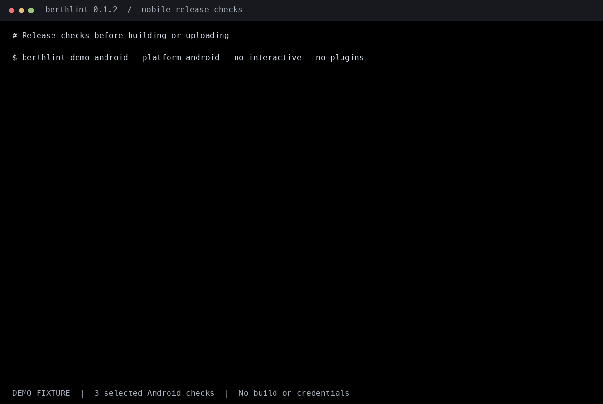

# Berthlint

Catch avoidable release problems in native iOS and Android apps **before building
or uploading**. Berthlint statically checks project files and fastlane store
metadata; it needs no store credentials, Xcode, Android SDK, or network access.

**32 built-in rules** cover native project settings, privacy and permission
declarations, and store listings. Extend checks with trusted JavaScript plugins.
Berthlint has not yet been published to npm.



*Focused Android fixture: the demo checks one rule; a passing scan is not a
guarantee of store acceptance.*

## What it checks

- **iOS:** SDK and deployment requirements, privacy manifests, usage descriptions,
  transport security and version consistency.
- **Android:** submission target SDK, exported components, permissions, debugging
  settings and version codes.
- **Store listings:** fastlane metadata fields, localization completeness, and
  screenshot dimensions and counts.
- **CI output:** readable text, JSON, SARIF and GitHub workflow annotations.

## In this README

- [Get started](#get-started)
- [How this differs](#how-this-differs)
- [CLI and exit codes](#cli)
- [Recognized project layouts](#recognized-layouts)
- [Configuration](#configuration)
- [Built-in checks](#checks)
- [Rule documentation](#rule-documentation)
- [Architecture and plugins](#architecture-and-plugin-api)
- [Continuous integration](#ci)
- [Policy data and limitations](#policy-data-and-limitations)
- [Contributing](#contributing)

## Get started

Requires Node.js **22.18+** (Node 24 LTS recommended) and npm.

```sh
npm install
npm run build
node dist/cli.js /path/to/mobile-app
```

For development, TypeScript runs directly on Node:

```sh
npm run dev -- /path/to/mobile-app --strict
npm run check
```

From a checkout, install the CLI locally with `npm link`, then run `berthlint`
inside a mobile repository. `npm pack` creates an installable package.
The package is prepared for `npx berthlint` once published; that command does not
currently refer to this unpublished checkout.

After `0.1.0` is published, a clone and local build will no longer be necessary:

```sh
npx berthlint@0.1.0 /path/to/mobile-app
# Or install a pinned CLI:
npm install --global berthlint@0.1.0
```

### How this differs

Berthlint complements existing release tools rather than replacing them:

- **fastlane** automates builds, signing, screenshots and uploads. Berthlint reads
  project files and fastlane metadata before those steps, without store credentials.
- **SwiftLint and Android Lint** focus on source quality and platform-specific
  analysis. Berthlint focuses on release settings and listing metadata across
  both stores; it does not replace compiler-backed checks.
- **App Store Connect and Google Play Console** validate actual uploads and
  listings. Berthlint offers earlier, offline feedback but cannot inspect remote
  state, certify a built artifact or predict a store review decision.

## CLI

```sh
berthlint . --platform ios
berthlint . --format json
berthlint . --format sarif --output berthlint.sarif
berthlint . --format github --strict
berthlint . --config config/release.json
berthlint . --platform ios --ios-sdk-version 26.0 --xcode-version 26.0
berthlint . --no-interactive
berthlint . --no-plugins
berthlint . --suppressions config/accepted-findings.json
berthlint --list-rules
```

| Option | Default | Description |
| --- | --- | --- |
| `--platform` | `all` | `ios`, `android`, or `all`; excludes the other platform's native loaders and metadata |
| `--format` | `text` | `text`, `json`, `sarif` (2.1.0), or `github` workflow annotations |
| `--output` | stdout | Report file, relative to the current working directory |
| `--config` | `berthlint.config.json` | Config path relative to the scanned project |
| `--ios-sdk-version` | config value | User-declared iOS SDK used to build, **not** the deployment target |
| `--xcode-version` | config value | User-declared numeric Xcode release version |
| `--no-interactive` | false | Disable the missing-SDK prompt |
| `--no-plugins` | false | Never resolve, import or execute configured JavaScript plugins |
| `--suppressions` | `berthlint.suppressions.json` | Exact-match accepted findings, relative to the scanned project |
| `--strict` | false | Treat warnings as CI failures |
| `--list-rules` | false | List rules, default severities and titles without scanning |

Exit codes: **0** no errors, **1** validation errors (or warnings in strict mode),
**2** execution failure, including malformed inputs, unknown rules, broken plugins
and unsupported/empty projects. Execution failures go to stderr, not into a
success-shaped JSON report. Notes never cause a failure.

JSON output is `{ schemaVersion: 1, findings: [...], summary: { error, warning, note } }`.
Each finding includes a stable `ruleId`, severity, project-relative file, optional
1-based source line, message, fix suggestion and policy URL. Findings are sorted
deterministically. No report format claims that a clean scan guarantees acceptance.

## Recognized layouts

```text
mobile-app/
  App.xcodeproj/project.pbxproj
  App/Info.plist
  App/PrivacyInfo.xcprivacy
  App/*.swift
  app/build.gradle.kts
  app/src/main/AndroidManifest.xml
  app/src/main/**/*.kt
  fastlane/
    metadata/
      en-US/name.txt
      en-US/subtitle.txt
      en-US/keywords.txt
      en-US/description.txt
      en-US/promotional_text.txt
      en-US/release_notes.txt
      android/en-US/title.txt
      android/en-US/short_description.txt
      android/en-US/full_description.txt
      android/en-US/images/phoneScreenshots/*.png
      android/en-US/images/sevenInchScreenshots/*.png
    screenshots/en-US/*.png
```

Native files are discovered recursively. Platform-specific `ios/fastlane/...` and
`android/fastlane/...` layouts also work. Standalone `Info.plist` and root
`AndroidManifest.xml` are supported for simple projects. When an Xcode project is
present, only its application and app-extension targets are loaded, not unrelated
test or framework plists. iOS locale-local `screenshots/` directories are also read.

Dependency/build directories (`Pods`, `Carthage`, `node_modules`, `build`, `dist`,
`DerivedData`, `.gradle`, `.build`, `vendor`, `.swiftpm`, `coverage`) and symlinks are
not traversed. Only XML plists are supported, not binary plists. PNG/JPEG screenshot
headers are read without decoding the image; corruption beyond the headers and
alpha channels are not checked.

Native projects without discovered store metadata produce a coverage warning.
Empty locale folders produce completeness warnings instead of a clean scan.
One final line ending and a leading UTF-8 BOM are removed from metadata; other
whitespace is retained for length checks.

## Configuration

All properties are optional; unknown properties and rule IDs are errors.

```json
{
  "defaultLocale": "en-US",
  "configuration": "Release",
  "iosSdkVersion": "26.0",
  "xcodeVersion": "26.0",
  "androidDevice": "phone",
  "metadata": {
    "ios": "fastlane/metadata",
    "android": "fastlane/metadata/android"
  },
  "screenshots": {
    "ios": "fastlane/screenshots"
  },
  "previousAndroidVersionCode": 41,
  "plugins": ["./tools/release-rules.mjs"],
  "rules": {
    "ios/transport-security": "warning",
    "ios/deprecated-apis": "off",
    "metadata/localizations": { "severity": "error" }
  }
}
```

Paths are relative to the scanned project. `androidDevice` accepts `phone`, `wear`,
`automotive`, `tv` and `xr`; it selects the published **submission/update** target
SDK minimum, not the existing-app availability threshold. Non-phone screenshot
checks are explicitly skipped with a coverage warning.

Xcode configuration names must match exactly; Berthlint does not guess another
configuration or silently skip targets when `Release` is absent. Override with
`--configuration <name>` or the `configuration` setting. For example, Firefox
iOS uses `Firefox` for its archive configuration. Its repository also contains
Focus, so scan the Firefox app subdirectory:

```sh
npm run dev -- /path/to/firefox-ios/firefox-ios --configuration Firefox
```

For a reproducible git release comparison, set `"baselineTag": "v1.2.0"` instead
of `previousAndroidVersionCode`. Berthlint reads each module's Gradle file at that
tag without checking it out. If both are set, `baselineTag` takes precedence.
Missing tags, missing baseline files or unresolved baseline versions are execution
errors. No tag is guessed automatically: a marketing version tag alone does not
reveal Android's build number. Without a baseline, a note reports the skipped check.

Rule values are `off`, `error`, `warning`, or `note`, either directly or in a
`{ "severity": ... }` object. `system/analysis` controls loader coverage diagnostics.

### Adopt without disabling rules globally

Commit a `berthlint.suppressions.json` file in the scanned project to accept
reviewed findings while still checking for new ones:

```json
{
  "schemaVersion": 1,
  "suppressions": [
    {
      "ruleId": "ios/deprecated-apis",
      "file": "App/LegacyView.swift",
      "message": "Deprecated iOS API: UIWebView.",
      "reason": "Legacy migration tracked in the team's release backlog."
    }
  ]
}
```

Copy `ruleId`, `file` and `message` exactly from a JSON report. All three must
match; paths use forward slashes and are relative to the scanned project (`.` is
valid for project-wide findings). There are no globs or whole-rule suppressions.
Source line numbers are intentionally ignored so nearby edits do not invalidate
an accepted finding. The same rule/file/message at multiple lines is suppressed
at every occurrence; a different message, file or rule remains visible.

Each entry requires a nonblank reason. Unknown rule IDs, duplicate entries,
unknown fields, malformed JSON and missing explicitly selected files are
execution errors. A missing default file means no suppressions. Unmatched entries
are retained without error; remove obsolete entries during review.
Suppressed findings are excluded from all report formats, summary counts and
exit-code decisions. Rules still execute and execution failures are never
suppressed. This keeps the report schema unchanged.

Use `--suppressions <file>` for another file. API callers can use
`loadSuppressions(root, path)` and pass the result to
`runRules(model, rules, config, { suppressions })`.

### iOS SDK, Xcode and deployment targets

The **build SDK** and **deployment target** are different. An app can be built with
the iOS 26 SDK while supporting iOS 15 devices. Do not enter `15.0` as the SDK just
because `IPHONEOS_DEPLOYMENT_TARGET` is `15.0`.

Berthlint compares the declared SDK and optional Xcode release against the dated
App Store upload requirements. CLI values override config values. These inputs
describe your intended build; they do **not** prove which SDK/Xcode built an archive.
`SDKROOT = iphoneos` and project migration markers are not used to guess versions.

If a native iOS app is found and no SDK is supplied, Berthlint prompts **only** for
a text scan with stdin, stdout and stderr attached to terminals, no `--output`,
no nonempty `CI` environment variable, and no `--no-interactive`. Disabling
`ios/sdk-requirements` also disables the prompt. Enter skips it; an invalid
nonempty answer is an execution error. Answers are not saved to config.
JSON, SARIF, GitHub annotations, redirected output, Android-only scans and CI
never prompt. Missing SDK information produces a nonblocking coverage note.

Deployment targets come from the selected Xcode configuration (target settings
override project settings), or `MinimumOSVersion` in standalone plists. They are
checked for numeric format, the dated App Store deployment minimum (iOS 13+
since September 9, 2026), and against the declared SDK. The stricter Xcode
deployment support floor is checked only for families explicitly recorded in
policy data (currently Xcode 26 and 27: iOS 15+). Device debugging support is a
different column in Apple's table and is not used as a deployment minimum.
Missing/unresolved targets or unknown/undeclared Xcode support produce coverage
notes. xcconfig files and build-command overrides still require manual verification.

## Checks

Every rule includes a default severity, remediation and official policy/help link.
Warnings identify review work or heuristics, not certain store rejections.

| Rule | Default | Checks |
| --- | --- | --- |
| `ios/usage-descriptions` | warning | Camera, microphone, location, photos, contacts, speech and Bluetooth API hints vs usage strings |
| `ios/privacy-manifest` | error | Missing manifest when a supported required-reason API is detected |
| `ios/privacy-schema` | error | Privacy field types, required-reason entries, reason-code syntax, collected-data entry completeness and tracking domains |
| `ios/required-reasons` | warning | Detected API categories without a declared nonempty reason |
| `ios/transport-security` | warning | Broad ATS bypasses and domain exceptions |
| `ios/version-format` | error | Resolved release marketing version and build-number format |
| `ios/version-consistency` | warning | Version/build mismatches among app/extension targets in the same project |
| `ios/deprecated-apis` | warning | `UIWebView`, `UIAlertView`, `UIActionSheet` |
| `ios/sdk-requirements` | error | Declared iOS SDK and Xcode releases vs dated App Store upload minimums |
| `ios/sdk-coverage` | note | Missing user-declared build SDK |
| `ios/deployment-target` | error | Numeric target, dated store OS minimum, target vs declared SDK, documented Xcode deployment floor |
| `ios/deployment-target-coverage` | note | Missing/unresolved target or unverified Xcode support range |
| `android/target-sdk` | error | Device-specific Play submission target API minimum; unresolved values are reported |
| `android/exported-components` | error | Explicit exported values on activities, aliases, services and receivers with intent filters at target 31+ |
| `android/version-code` | error | Literal integer from 1 through 2100000000 |
| `android/version-increment` | error | Code strictly higher than the supplied previous release |
| `android/version-baseline` | note | Missing prior-release comparison coverage |
| `android/version-name` | warning | Nonempty, statically resolved version name |
| `android/sensitive-permissions` | warning | Selected SMS, call-log, background-location, package and storage permissions |
| `android/missing-permissions` | warning | Camera, microphone and location API hints vs source manifest declarations |
| `android/debuggable` | error | Debugging explicitly enabled in the main manifest |
| `android/cleartext-traffic` | warning | Cleartext traffic explicitly enabled |
| `android/deprecated-apis` | warning | `AsyncTask`, framework `Fragment`, `startActivityForResult` |
| `metadata/lengths` | error | iOS name/subtitle/keywords/description/promotional text/release notes and Android title/short/full description |
| `metadata/completeness` | warning | Summarized absent required files or screenshot sets, without assuming remote/fallback values |
| `metadata/required-fields` | error | Blank/too-short mandatory listing fields that are present locally |
| `metadata/localizations` | warning | Default locale presence and optional-field parity, without duplicate required-field findings |
| `metadata/screenshot-dimensions` | error | Known iPhone/iPad sizes, Play phone/tablet 320–3840 px and maximum 2:1 aspect ratio |
| `metadata/screenshot-counts` | error | Present screenshot sets: Android 2+ total; maximum 10 per iOS display group / 8 per Android group |
| `metadata/ios-required-screenshots` | warning | Current/scalable iPhone groups and 13-inch iPad assets where iPad support is known |
| `system/requirements-stale` | warning | Policy data older than its 180-day review window |
| `system/specialized-android-store` | warning | Unsupported device-specific screenshot coverage |

iOS keywords are measured in **UTF-8 bytes**, not JavaScript string length.
Other text limits count Unicode code points; store-side counting of complex
graphemes may differ.

### Local listing completeness versus invalid values

Absent metadata files and entirely absent local screenshot sets produce grouped
`metadata/completeness` warnings, with all affected locales listed. Berthlint
cannot inspect existing remote listings or prove which fallback the store will
apply. It never silently fills values from another locale. Present blank required
fields, overlong strings, invalid image sizes, excess counts and undersized
nonempty screenshot sets remain errors. Required-field absence/blank values are
not repeated as localization parity warnings.

For a listing that must be self-contained locally, configure:

```json
{
  "rules": {
    "metadata/completeness": "error"
  }
}
```

`--strict` also fails on completeness warnings, as it does on other warnings.
This intentionally changes first-run behavior: an absent local screenshot set
alone no longer proves a blocking store submission error.

### Source ownership and repeated findings

iOS usage-description checks use explicit Sources build phases and Xcode
filesystem-synchronized groups, including membership exceptions. Known non-iOS
targets are excluded; sources owned only by Watch/test targets are not treated as
iOS app usage. Sources shared with an iOS app are retained. For sources that
cannot be mapped (such as package code), one ownership-review warning per
permission replaces missing-string claims against every unrelated extension.
Standalone plists retain heuristic source checks because target membership is
unavailable. Swift package reachability is not inferred.

Version-consistency checks exclude missing/unresolved version/build pairs.
xcconfig and deployment-coverage messages group affected targets by project
without hiding which targets were skipped. Deprecated-API checks ignore
import-only lines and report each API once per file at its first non-import use.
Warnings still require review; they are not automatic store rejections.

## Rule documentation

The [static rule reference](./docs/index.html) contains one page per rule, with the
reason for the check, limitations, remediation, default severity and official
policy link. Open it locally in a browser, or serve the `docs/` directory with any
static web server. The pages need no dependencies or JavaScript and are included
in the npm package. Public hosting is a separate release step.

Generate it with `npm run docs` after changing rule metadata. `npm run docs:check`
and `npm run check` reject stale or missing pages. Reproducible release checks are
documented in [release validation](./docs/release-validation.md).

## Architecture and plugin API

```text
filesystem -> project loaders -> normalized ProjectModel -> pure rules -> reporters
                                   ^
                           versioned policy JSON
```

Built-in rules never read the filesystem. The exported model, rule types, loaders,
engine, reporters and requirements data can also be used programmatically.

A plugin is an ESM or CommonJS package, or a local JavaScript module, exporting
`{ rules: Rule[] }` as its default export or exporting a named `rules` array.
Package resolution is relative to the scanned project and honors ESM exports.

```js
// tools/release-rules.mjs
/** @type {import("berthlint").BerthlintPlugin} */
export default {
  rules: [{
    id: "team/support-url",
    title: "Support URL checklist",
    platform: "ios",
    severity: "warning",
    policyUrl: "https://developer.apple.com/app-store/review/guidelines/",
    fix: "Confirm the support URL works before submission.",
    check(model) {
      return model.ios.map(bundle => ({
        file: bundle.file,
        message: "Manually verify the published support URL."
      }));
    }
  }]
};
```

Rule IDs are namespaced (`namespace/kebab-case`). `check(model, context)` is
synchronous and returns `{ file, line?, message, policyUrl? }[]`; context contains the default
locale, Android device category, current date, and optional declared SDK/Xcode
versions. Optional rule `description` metadata supplies the explanation for
generated documentation. The engine supplies severity,
policy URL and remediation from the rule metadata. A result can override the
policy URL when a cross-platform rule needs a store-specific link. Throwing rules, malformed
findings and duplicate IDs fail explicitly.

**Plugins execute with the user's full permissions. They are not sandboxed.**
Only enable trusted packages. Pass `--no-plugins` when scanning untrusted pull
requests; this prevents plugin resolution, imports (including top-level code)
and rule execution, including with `--list-rules`. API callers can use
`loadRules(root, config, { plugins: false })`. Unknown configured rule overrides
still fail explicitly, so use a trusted config without plugin-only overrides.
Treat the model as read-only and keep checks deterministic and filesystem-free.

Disabling plugins is not a sandbox or protection against changed rule settings
or suppressions. Use a least-privilege job without secrets for untrusted PRs,
keep the tool/config/suppressions under trusted control, and do not run PR code
with privileged `pull_request_target` credentials. See [SECURITY.md](./SECURITY.md).

## CI

Run the built CLI directly in any CI with Node 22.18+.

The included [composite action](./action.yml) builds this checkout and emits GitHub
annotations. After checking out Berthlint into a `tools/berthlint` subdirectory:

```yaml
- uses: ./tools/berthlint
  with:
    path: .
    strict: "true"
    no-plugins: "true"
    platform: all
    ios-sdk-version: "26.0"
    xcode-version: "26.0"
```

Once a maintainer pushes the `v0.1.0` release tag, replace
`uses: ./tools/berthlint` with `uses: elusivestudio/berthlint@v0.1.0` and omit the
separate tool checkout. The composite action builds its own tagged source;
it does not depend on npm publication. Pin a reviewed commit SHA for stronger
immutability. The `no-plugins` input defaults to `"false"` for compatibility;
enable it for untrusted code. An optional `suppressions` input selects a
project-relative suppressions file.

Alternatively run `node /path/to/berthlint/dist/cli.js . --format sarif --output
berthlint.sarif` and upload with `github/codeql-action/upload-sarif` using
`sarif_file: berthlint.sarif` and `security-events: write` permissions.
Run the upload step with `if: always()` because validation findings return 1.
SARIF paths are relative to the scanned project; set the upload action's
`checkout_path` accordingly if scanning a subdirectory.

Repository CI runs strict source/test type-checking, tests, compilation and a
generated-docs check and installable-package smoke test on Node 22 and 24.
Run `npm run smoke:package` locally to pack and install into a temporary consumer,
then verify the CLI, JSON report, public ESM exports and packaged documentation.
This needs npm registry access and does not publish anything.
A weekly workflow fails when the
requirements review date is overdue; it does not automatically change policies.

### fastlane

After installing a pinned CLI (currently via `npm link` from a checkout), put the
check before the existing build/upload steps in your `Fastfile`:

```ruby
lane :release do
  # fastlane executes lanes from fastlane/; .. is the mobile project root.
  sh("berthlint .. --strict --no-interactive --no-plugins --ios-sdk-version 26.0 --xcode-version 26.0")
  build_app
  upload_to_app_store
end
```

Use the SDK/Xcode versions intended for your build. For Android, use
`--platform android` instead of the SDK/Xcode options, then run your existing
`gradle` and `upload_to_play_store` steps. A nonzero `sh` result stops the lane.

**Don't bypass the gate:** keep Berthlint as a required CI check and run it
before build/upload. Do not mask failures with `|| true`, `continue-on-error` or
a rescued fastlane error. Triage findings and add narrow, reasoned suppressions
for accepted exceptions rather than disabling whole rules. A passing check is
still not a guarantee of acceptance.

## Policy data and limitations

Store limits live in [versioned JSON](./src/requirements/store.v1.json), with a
`verifiedOn` date and official source URLs. Baseline verified **2026-11-10**.
Review the linked sources before relying on a release decision. A future policy
change needs a data/rule update; runtime validation never fetches policy changes.

This is static triage, **not an App Review replacement**:

- Gradle is not executed. Literal Groovy/Kotlin settings and supported default
  version-catalog/property references are resolved statically. For assignment-form
  declarations, supported examples are `libs.versions.app.targetSdk.get().toInt()`
  and `project.property("VERSION_CODE").toString().toInt()`; string values may omit
  `.toInt()`. Simple single-line `val` aliases and catalog application-plugin
  aliases are supported. Only root `gradle/libs.versions.toml` and
  `gradle.properties` are read; custom catalogs, providers, environment values,
  arbitrary variables, arithmetic, plugin execution and manifest merging are not
  evaluated. Unsupported declared values remain unresolved with diagnostics,
  rather than silently falling back to manifest values. Historical version
  comparisons read shared values from the baseline tag, not today's files.
  Detected flavors/overrides produce a coverage warning. Libraries can contribute
  permissions or components that are absent from the source app manifest.
- Xcode's selected configuration and directly inherited project settings are
  inspected. Referenced xcconfig files produce a warning; nested variables,
  conditional settings, localized usage strings and build-generated values may
  remain unresolved. SDK/Xcode checks validate user declarations and deployment
  targets, not the actual build environment or artifact. They cannot certify
  the uploaded archive's toolchain or OS compatibility.
- Source scanning is a conservative token heuristic, not compiler analysis. It
  excludes ordinary comments but may flag strings or inactive code. Direct Xcode
  source membership is inspected, but package dependency reachability and
  conditional compilation are not reconstructed. Unmapped usage requires review.
- Privacy coverage is compared across discovered manifests, not executable bundle
  membership. A declaration in a sibling target does **not** prove compliance.
  Reason-code syntax and category presence are checked, not whether Apple approves
  that code for the category or whether the claimed reason is truthful. Third-party
  SDK privacy practices and manifests require independent review.
- Metadata/localization completeness is advisory by default: remote listing state
  and deliberate locale fallback are not inspected. Promote completeness warnings
  to errors when your release process requires a fully local listing.
- Screenshot checks cover iPhone/iPad and Android phone/tablet listing images,
  not videos, icons, image content, alpha, watch/TV/XR assets or all scaling rules.
  Published iPhone Duo dimensions are recognized. Apple's April 2027 SDK-dependent
  Duo screenshot requirement is not yet enforced; re-verify its final activation
  details before releases in that period.
- Built `.ipa`/`.aab` files, uploading, credentials, React Native/Flutter-specific
  layouts and exhaustive deprecated-API analysis are outside this first release.

Berthlint is an independent project, not affiliated with or endorsed by Apple Inc.
or Google LLC. App Store and Google Play names belong to their respective owners.

## Contributing

Add pure rules under [src/rules](./src/rules), export them in the rule registry,
and include passing/failing cases and exact boundary tests. Native parser changes
belong in [src/loaders](./src/loaders), with representative fixtures under
[test/fixtures](./test/fixtures). Policy changes need source verification and a
review-date update, not just a changed constant. Run `npm run check` before
submitting changes.

Report reproducible bugs or false positives using the repository's issue
templates. Report vulnerabilities privately as described in
[SECURITY.md](./SECURITY.md). See the [changelog](./CHANGELOG.md) and
[release instructions](./docs/releasing.md) for distribution status and the
provenance-enabled publication process.

MIT licensed.
